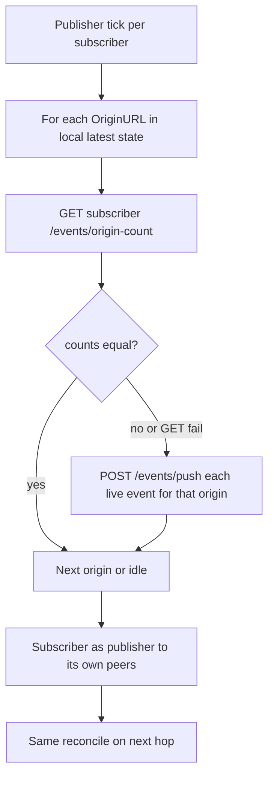

# ADR: Peer lifecycle via origin-count reconciliation

## Status

Proposed

## Context

Nodes form a directed **Replication** graph: a **publisher** pushes **Events** to the peer URLs it holds as subscribers, and those peers may forward onward. Edge identity is the stable base API URL (`Node.url`, event `OriginURL`). Provenance (`OriginURL` + timestamp) is stamped once at the producing node and preserved across hops.

What is still missing:

1. A cheap way for a publisher to know whether a subscriber is missing resources that this hop should hold.
2. Automatic refill so that in a chain `A → B → C`, if the middle node dies and returns empty, the chain eventually converges again without operator intervention.

### What the code does today

- Live push with short retries, then forever latest-state resync on failure ([internal/events/notify.go](../../internal/events/notify.go)).
- Register replays the publisher’s full latest state once ([internal/events/manager.go](../../internal/events/manager.go)).
- There is no per-origin inventory check between hops. A quiet stream looks like a healthy empty gap. A middle node that restarts empty is not systematically refilled by origin.

Domain terms: **Node**, **Replication**, **Event**, **Ingress**. A **publisher** is the node that pushes events. A **subscriber** is the peer URL it pushes to.

## Decision

### Count meaning

`GET /events/origin-count?originUrl=<uri>` returns the number of **live** resources in the node’s latest state whose `OriginURL` equals the query parameter. It is not the history-ring length.

### Hop-by-hop reconcile

Each publisher, periodically for each registered subscriber:

1. For every distinct `OriginURL` present in the publisher’s own latest state (not only `selfURL`, so forwarders refill upstream-originated resources), ask the subscriber for that origin’s live count.
2. Compare to the publisher’s local live count for the same origin.
3. If the counts differ, or the GET fails, resend that origin’s live events over `POST /events/push` (Create-shaped snapshot entries; provenance preserved).
4. Keep the subscriber URL registered and retry on the next tick.

Configured URLs (`Node.subscriptions` / `--subscribers`) stay and are retried. Session peers from `POST /events/register` remain in-memory for the publisher process life; after a publisher restart they must register again.

Live push with short retries stays for steady-state delivery. Origin-count reconcile owns catch-up after queue overflow, exhausted retries, or a peer that was empty or behind.

### Chain refill

In `A → B → C`, if `B` returns empty:

1. `A` sees count mismatch for origins it holds and resends to `B`.
2. `B`, once filled, reconciles with `C` for every origin in `B`’s latest state (including `OriginURL=A`), and resends.

No skip-middle discovery: each hop only talks to its direct subscribers.

### What we do not do

- No `publisherLost` / `subscriberLost` marks on events or edges.
- No incarnation id.
- No network scan or service discovery.
- No ApiInstance endpoint probes as node liveness.
- No delete of a landscape because a peer blipped; deletes come only from real Delete events or a later snapshot that no longer contains a resource when full-state paths already defined that behaviour.
- No per-event undelivered queue across a lost hop; recovery is origin-scoped resend of live state.

## Activity

## Out of scope

- Configurable reconcile interval (constant for now).
- Comparing resource id sets when counts accidentally match.
- Using origin-count for operator dashboards beyond the replication path.
